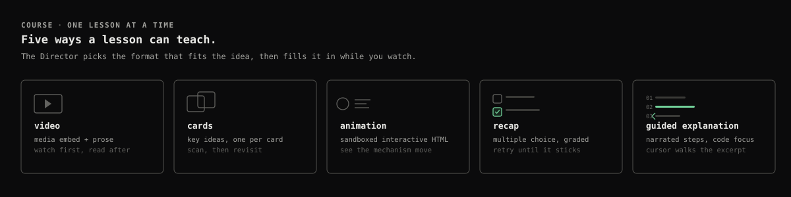
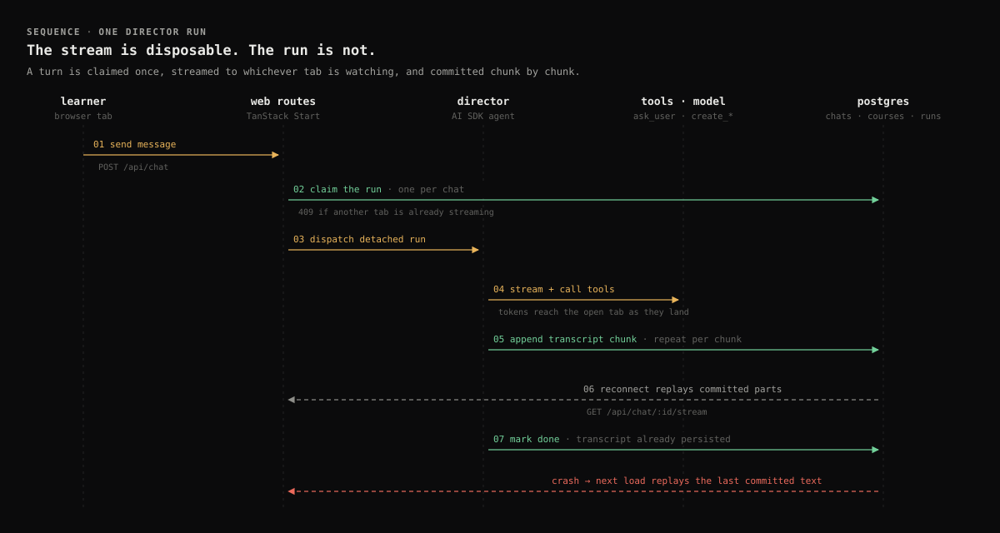
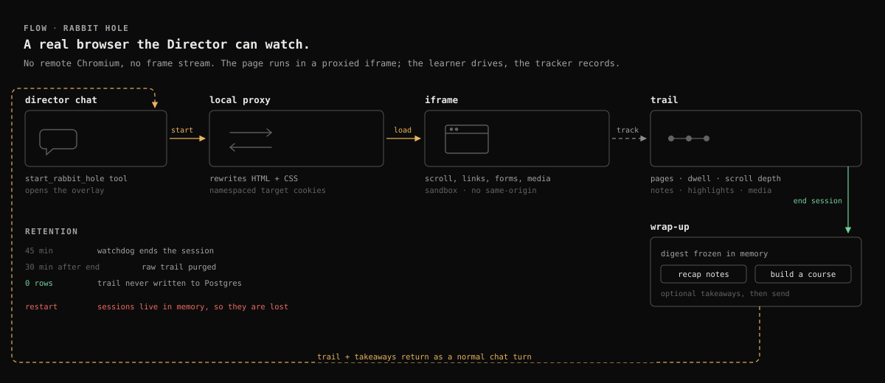

<h1 align="center">Curio</h1>

<p align="center">
  <strong>Learn anything, your way.</strong><br />
  An AI Director that turns a conversation into a course you can keep.
</p>

<p align="center">
  <a href="#project-status"></a>
  <a href="LICENSE"></a>
  <a href="https://pnpm.io"></a>
  <a href="https://www.typescriptlang.org"></a>
</p>

Curio is an AI-powered learning app built around a conversational agent called **the Director**. You tell it what you want to learn; it asks a few questions about your level and goals, plans a course, and then writes the lessons — video prose, card decks, interactive animations, graded quizzes and narrated code walkthroughs — directly in the chat.

Everything is self-hosted and open source. You can run it with your own model key, or let each user plug in their own OpenAI-compatible provider.

> **Status:** active MVP. Expect rough edges, especially around deployment and the optional third-party integrations described below.

---

## Contents

- [Why Curio](#why-curio)
- [Features](#features)
- [Lesson formats](#lesson-formats)
- [How a course gets built](#how-a-course-gets-built)
- [Rabbit Hole](#rabbit-hole)
- [Tech stack](#tech-stack)
- [Repository layout](#repository-layout)
- [Getting started](#getting-started)
- [Environment variables](#environment-variables)
- [Available scripts](#available-scripts)
- [Deployment notes](#deployment-notes)
- [Security](#security)
- [Project status](#project-status)
- [Documentation](#documentation)
- [Contributing](#contributing)
- [License](#license)

## Why Curio

- **Talk to learn.** No course builder, no lesson editor. The Director interviews you in chat and builds the structure as the conversation moves.
- **The right format for the idea.** A concept gets a video. A vocabulary gets cards. A mechanism gets an animation. A mental model gets a quiz. Code gets a narrated walkthrough with a cursor that points at the line being discussed.
- **Progress that survives.** Transcripts, course structure, completed lessons and badges live in Postgres. Agent runs are committed chunk by chunk, so closing the tab or dropping the connection does not throw the work away.

## Features

- **Director chat** — streaming agent chat with visible tool calls, web search, page reading, clarifying questions and a session-files rail for every link, artifact, image, video and file in the conversation.
- **Durable runs** — each turn is claimed once, streamed to whichever tab is watching, and persisted before it is marked done. Reopening a chat replays the run; a second tab gets `409` instead of starting a duplicate generation.
- **Courses** — sections and lessons in five formats, with progress that picks up where you left off, per-lesson completion and completion badges on the Courses page.
- **Rabbit Hole** — a disposable, proxied browser the learner drives themselves, with per-page capture and Director notes, digested into recap notes or a course on exit.
- **Artifacts** — publish generated HTML, Markdown, SVG or text documents to an optional Artifact Server and review them in a sandboxed iframe.
- **Guided explanations** — step-by-step narrated explanations with code focus, a moving cursor and optional local text-to-speech.
- **Bring your own model** — use the server default or save a per-user OpenAI or OpenAI-compatible provider from Settings.
- **Learning preferences** — free-text guidance for how the Director should teach you — pace, depth, tone, examples, study strategies — saved per user and added to the chat instructions.
- **Multi-user auth** — Better Auth email/password sessions backed by Postgres.
- **Theming and polish** — light/dark/system themes, interaction sounds and a responsive mobile dock.

## Lesson formats

<p>
  
</p>

| Format | What it does |
| --- | --- |
| **Video** | An embedded video or media clip with teaching prose around it. |
| **Cards** | A deck of short, scannable cards — key ideas one at a time. |
| **Animation** | A self-contained HTML animation in a sandboxed iframe, for mechanisms that need to move. |
| **Recap** | Two to four multiple-choice questions with explanations, a score and a retry loop. |
| **Guided explanation** | A timed, narrated walkthrough: steps reveal code or diagrams, focused lines stay bright, and a cursor points at the exact token being discussed. |

The Director picks the mix from the course brief rather than forcing every topic through the same template.

## How a course gets built

<p>
  
</p>

<p><sub>How one turn is claimed, streamed and committed — and what happens when the stream drops.</sub></p>

The Director is instructed to:

1. Ask a few multiple-choice questions about the learner's level and goals with `ask_user`.
2. Create a course outline with `create_course` (sections plus empty lessons).
3. Fill every lesson in order with `create_lesson` — video prose, card decks, quiz questions, HTML animations, guided explanations.
4. Optionally publish a standalone deliverable with `create_artifact`.

Course and chat data live in Postgres. Agent runs are committed to the database chunk by chunk, so reopening a chat replays the run instead of re-requesting the model. Submitting a message claims a per-chat running run atomically; a second tab gets `409` instead of starting a duplicate generation. The transcript is persisted before the run is marked `done`, and a crashed process hands back its committed partial text on the next load.

Course lessons are filled by a detached background fiber. The course page polls the structure and swaps in content as it lands, so leaving the page never cancels the model work.

## Rabbit Hole

<p>
  
</p>

<p><sub>The proxied browser and its in-memory trail, from start tool to wrap-up.</sub></p>

A Rabbit Hole is a disposable, proxied browser session that the Director can summon from chat. There is no server-side Chromium and no frame stream: the page loads in an iframe through a local reverse proxy, so it is genuinely interactive and cheap to run.

- The learner types a URL or search in the omnibox, then clicks, scrolls, selects, types and plays media directly in the page.
- Every visit records the URL, title, dwell time, scroll depth and a capped chunk of visible text, plus notes, highlights and media.
- Ending the session produces a polished digest and a deterministic trail digest. Choosing **Recap notes** or **Build a course** sends that material back to the Director as a normal chat turn.
- The raw trail is never written to Postgres; it is purged 30 minutes after the session ends, and a watchdog closes sessions after 45 minutes.

Read the [Rabbit Hole deep dive](docs/rabbit-hole.md) for the proxy rewriting, cookie isolation, tracker protocol and current limits.

## Tech stack

| Layer | Choice |
| --- | --- |
| App framework | [TanStack Start](https://tanstack.com/start) + React 19 |
| API | [tRPC](https://trpc.io) and TanStack Start server routes |
| AI | [Vercel AI SDK](https://sdk.vercel.ai) |
| Effects / DI | [Effect](https://effect.website) v4 |
| Database | PostgreSQL + [Drizzle ORM](https://orm.drizzle.team) |
| Auth | [Better Auth](https://www.better-auth.com) |
| UI | Tailwind CSS v4, shadcn/ui primitives, Base UI |
| Markdown / code | [Streamdown](https://streamdown.ai) + Shiki |
| Tooling | pnpm workspaces, Vite+, Oxlint/Oxfmt (Ultracite) |

## Repository layout

```
curio/
├── apps/
│   └── web/                 # TanStack Start app: routes, UI, server routes
├── packages/
│   ├── api/                 # Domain, services, infrastructure, tRPC routers
│   │   └── src/
│   │       ├── domain/          # Pure types + typed errors
│   │       ├── services/        # Effect Context contracts (ports)
│   │       ├── infrastructure/  # Drizzle, AI SDK, MCP, web adapters
│   │       ├── routers/         # tRPC procedures
│   │       └── composition/     # Runtime/Layer wiring
│   ├── auth/                # Better Auth configuration
│   ├── db/                  # Drizzle schema, migrations, seed scripts
│   ├── ui/                  # Shared shadcn/ui + AI Elements components
│   └── config/              # Shared TypeScript config
├── docs/                    # Design notes + README illustrations
└── artifact-server/         # Optional local artifact server (git-ignored)
```

The dependency direction is `domain → services → infrastructure → composition`. The web app wires concrete adapters into a single Effect runtime in `apps/web/src/services.ts`; routers never construct database or model clients themselves.

## Getting started

### Quick start

```bash
pnpm install
cp apps/web/.env.example apps/web/.env   # fill in the required variables
pnpm db:push
pnpm dev
```

Open <http://localhost:3001> and sign up. The detailed steps below explain each part.

### Prerequisites

- Node.js with Corepack enabled
- [pnpm](https://pnpm.io) 11 (the repo pins `pnpm@11.8.0`)
- A PostgreSQL database
- An OpenAI or OpenAI-compatible API key for the server default model

### 1. Install dependencies

```bash
pnpm install
```

### 2. Configure environment

```bash
cp apps/web/.env.example apps/web/.env
```

On Windows, copy the file with `Copy-Item apps/web/.env.example apps/web/.env` or in Explorer. Then fill in `DATABASE_URL`, `BETTER_AUTH_SECRET`, `BETTER_AUTH_URL` and the AI provider variables. See [Environment variables](#environment-variables).

Generate a secret with:

```bash
openssl rand -base64 32
# or, without OpenSSL:
node -e "console.log(require('node:crypto').randomBytes(32).toString('base64'))"
```

### 3. Create the database schema

For local development, push the schema directly:

```bash
pnpm db:push
```

For an environment that tracks migrations, apply the checked-in migrations instead:

```bash
pnpm db:migrate
```

> `db:push` and `db:migrate` are alternative workflows. Do not mix them against the same database unless you know how Drizzle's migration journal is set up.

### 4. Run the app

```bash
pnpm dev
```

Open <http://localhost:3001>. Register an account, then open **Chat** and ask the Director to build a course. The web app is pinned to port `3001` in `apps/web/vite.config.ts`.

### 5. Point it at a model (optional)

The server default provider comes from `AI_BASE_URL`, `AI_API_KEY` and `AI_MODEL`. To use a different provider per user, open **Settings → Model provider**, choose OpenAI or OpenAI-compatible, and save a key. Per-user keys are encrypted at rest.

### Troubleshooting

| Symptom | Fix |
| --- | --- |
| `409` when sending from a second tab | A run is already streaming for that chat. This is intentional — stop or finish it in the other tab. |
| `web_read` returns an install hint | Install the [Obscura](https://docs.obscura.sh) CLI and put it on `PATH`, or set `OBSCURA_BIN`. |
| Artifact tools are missing | Set `ARTIFACT_SERVER_URL` (and usually `ARTIFACT_SERVER_API_KEY`); artifact tools are disabled without it. |
| A lesson says its content is on its way | The lesson predates the current content pipeline. Ask the Director to rebuild the course lesson. |
| Schema changes are not applying | Use either `pnpm db:push` or `pnpm db:migrate` consistently against the same database. |

## Environment variables

Core server configuration is validated in `apps/web/src/env.server.ts`.

| Variable | Required | Description |
| --- | --- | --- |
| `DATABASE_URL` | yes | PostgreSQL connection string. |
| `BETTER_AUTH_SECRET` | yes | Session secret, at least 32 characters. |
| `BETTER_AUTH_URL` | yes | Public URL of the app, e.g. `http://localhost:3001`. |
| `AI_BASE_URL` | yes | Base URL of an OpenAI or OpenAI-compatible API. |
| `AI_API_KEY` | yes | Server default model API key. |
| `AI_MODEL` | yes | Model ID used by default, e.g. `gpt-4o-mini`. |
| `AI_PROTOCOL` | no | `chat-completions` (default) or `responses`. |
| `AI_STRUCTURED_OUTPUTS` | no | `true` (default) sends JSON Schema response formats. Set `false` for gateways that reject them. |
| `MODEL_SETTINGS_ENCRYPTION_KEY` | no | At least 32 chars. Encrypts per-user model keys at rest; defaults to `BETTER_AUTH_SECRET` when unset. |
| `ARTIFACT_SERVER_URL` | no | MCP endpoint of an Artifact Server, e.g. `http://127.0.0.1:8787/mcp`. Origin-only URLs are normalized to `/mcp`. Enables artifact publishing. |
| `ARTIFACT_SERVER_API_KEY` | no | Bearer token for the Artifact Server (local token file: `artifact-server/.artifact-server/local-api-token`). |
| `OBSCURA_BIN` | no | Path/name of the Obscura CLI used by `web_read`. |
| `OBSCURA_STEALTH` | no | Set to `1` to pass `--stealth` to Obscura. |

Per-user model settings are stored in the `user_model_settings` table. API keys are encrypted at rest with AES-256-GCM (versioned `enc:v1:` values; legacy plaintext rows are read and re-encrypted on the next save) and are never returned by the API; responses expose only `hasApiKey`. A custom OpenAI-compatible `baseUrl` requires a per-user API key: the server `AI_API_KEY` is never sent to user-supplied hosts.

### Optional integrations

- **Obscura** (`web_read`) — install the [Obscura](https://docs.obscura.sh) CLI and make sure it is on `PATH`, or set `OBSCURA_BIN`. Without it, web search still works and `web_read` returns an install hint.
- **Artifact Server** (`create_artifact`) — point `ARTIFACT_SERVER_URL` at an Artifact Server MCP endpoint (`http://127.0.0.1:8787/mcp`; an origin-only URL is normalized automatically) and set `ARTIFACT_SERVER_API_KEY` to the server's bearer token. When the URL is unset, artifact tools are disabled. A reachability warning is logged at boot.

## Available scripts

| Command | What it does |
| --- | --- |
| `pnpm dev` | Start all workspaces in development mode. |
| `pnpm dev:web` | Start only the web app. |
| `pnpm build` | Build all workspaces. |
| `pnpm check-types` | Type-check every package. |
| `pnpm check` | Ultracite checks, workspace type checks, and tests. |
| `pnpm lint` | Run Oxlint. |
| `pnpm format` | Run Oxfmt. |
| `pnpm fix` | Apply Ultracite fixes and formatting. |
| `pnpm test` | Run the Vitest workspace suite. |
| `pnpm test:coverage` | Run the suite with coverage. |
| `pnpm db:push` | Push the Drizzle schema to the database. |
| `pnpm db:generate` | Generate a migration from schema changes. |
| `pnpm db:migrate` | Apply checked-in migrations. |
| `pnpm db:studio` | Open Drizzle Studio. |
| `pnpm auth:generate` | Regenerate the Better Auth Drizzle schema. |

## Deployment notes

- Curio is a long-running Node server, not a set of stateless edge functions. Durable agent runs keep process-local abort controllers/registrations in memory, so prefer a single persistent instance (or sticky sessions) unless you add shared coordination.
- Set `BETTER_AUTH_URL` to the exact public origin; it is the only trusted origin configured for Better Auth.
- Run migrations before starting the app: `pnpm db:migrate`.
- Email verification is not enabled, and Better Auth's rate limiter does not cover the AI routes. Add signup controls and per-user request/usage limits before exposing a public instance, especially if you pay for model usage.
- Generated artifacts and lesson animations render in an iframe sandboxed with `allow-scripts allow-forms` and a null origin. They cannot read Curio cookies or storage, but they can still make outbound network requests. Treat model-generated HTML as untrusted content.
- Rabbit Hole sessions live in the server process. Restarting the server drops open sessions, and the proxy is intended for local or single-user deployments.

## Security

- Never commit `apps/web/.env`; only `.env.example` belongs in git.
- Chat, course and artifact routes require an authenticated session and scope reads/writes to the session user.
- `web_read` rejects loopback, private, link-local and reserved addresses. It validates the initial URL and every HTTP redirect hop, and rejects hostnames that resolve to private addresses. It still cannot see JavaScript/meta-refresh redirects or DNS rebinding between the check and the browser fetch. If you need strong isolation, run the reader behind egress filtering or in a network-restricted sandbox.
- Per-user API keys are encrypted with AES-256-GCM before they are stored in Postgres. Set a dedicated `MODEL_SETTINGS_ENCRYPTION_KEY` in production and keep it stable: rotating it makes previously saved keys unreadable (users can re-enter them).
- A custom OpenAI-compatible `baseUrl` requires a per-user API key. The server `AI_API_KEY` is never sent to user-supplied hosts. Use the server default provider if you want to rely on the deployment key.
- Model-rendered markdown does not load remote images by default; `data:` and `blob:` images are allowed. The document CSP is intentionally image-only (`img-src 'self' data: blob:`) so narration model downloads and lesson video/media embeds keep working, while the `SafeMarkdownImage` component adds a second image layer. Use the artifact server or a local asset for rich media; do not add remote origins to `img-src` without an explicit allowlist/proxy.
- Rabbit Hole proxies real pages for the learner. The proxy can reach localhost and internal hosts, and the iframe is sandboxed without same-origin access. Treat the feature as trusted-local until an egress proxy or host allowlist is added.

## Project status

Curio is an active MVP built for local and single-user deployments first:

- Single server process: durable run coordination, Rabbit Hole sessions and abort controllers are in memory.
- No signup controls, email verification or AI usage limits yet.
- Optional integrations (Obscura, Artifact Server) degrade gracefully but are not required for the core flow.
- The UI and content schemas are still moving; breaking changes are possible.

## Documentation

- [Rabbit Hole](docs/rabbit-hole.md) — proxied browser architecture, capture, lifecycle and limits.
- [Guided explanations](docs/guided-explanation.md) — the narrated code/diagram lesson format and its milestones.

## Contributing

1. Fork and create a feature branch.
2. Run the local gates — `pnpm lint`, `pnpm check-types`, and `pnpm test` — before opening a pull request. Use `pnpm fix` to apply formatting and lint fixes.
3. Keep domain contracts in `packages/api/src/domain` and `services` free of framework imports.
4. Match the surrounding patterns: services are `Context.Tag`s, domain failures are `Data.TaggedError`s, and runtime wiring lives in `packages/api/src/composition` and `apps/web/src/services.ts`.

## License

[MIT](LICENSE)
